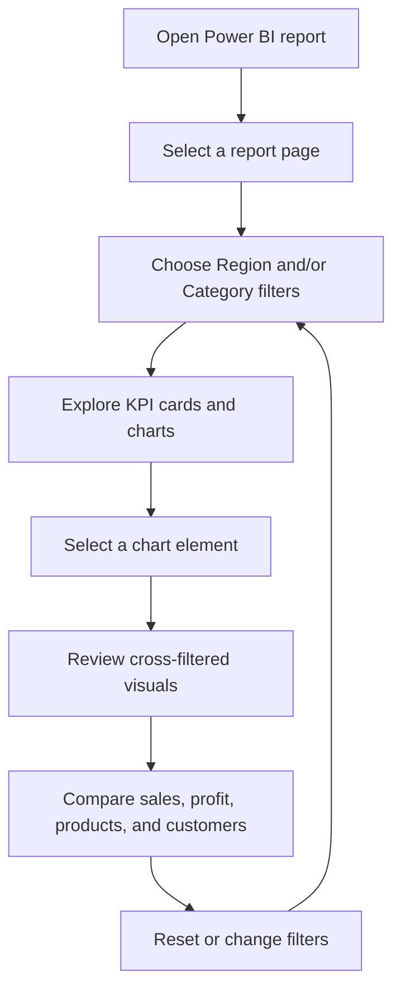
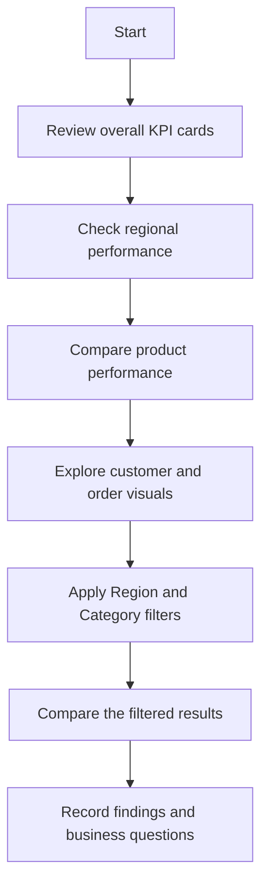

# Superstore Data Analysis Dashboard

An interactive Power BI project for exploring Superstore sales, profit, product performance, regional distribution, trends, and customer behavior.

## Project overview

This project contains a three-page Power BI report built around the **`Sample - Superstore`** dataset. It brings key business measures and interactive visualizations together so users can explore performance from sales, product, regional, and customer perspectives.

## Report pages at a glance

| Page | Focus | What it explores |
|---|---|---|
| Superstore Data Analysis | Overall performance | Sales, profit, products, orders, category and regional views |
| Trend Analysis | Performance patterns | Sales and profit views by product, plus region distribution |
| Customer Insights | Customer behavior | Customers by region, sales by region, preferred products, and customer orders |

## Dashboard workflow



## Page 1: Superstore Data Analysis

This page provides a high-level view of business performance.

### KPI cards

| KPI | Field / aggregation shown in report | Purpose |
|---|---|---|
| Total Sales | Sum of `Sales` | Overall sales value |
| Total Profit | Sum of `Profit` | Overall profit |
| Total Product | Non-null count of `Product ID` | Product ID count |
| Total Orders | Non-null count of `Order ID` | Order ID count |

### Charts and controls

| Visual title | Visual type | Fields shown |
|---|---|---|
| Sales vs Product | Clustered bar chart | Product Name and summed Sales |
| Sales By Category | Clustered bar chart | Region and summed Sales |
| Region vs Profit | Clustered bar chart | Region and Profit |
| Region Distribution | Donut chart | Region and non-null Order ID count |
| Region | Slicer | Region |
| Category | Slicer | Region field in the report visual definition |

The report page also contains decorative images and text elements.

### Page-level filter

The first page includes a page filter on `Ship Mode` with **Standard Class** and **Second Class** selected in the saved report definition. The saved report view has Standard Class and Second Class selected.

## Page 2: Trend Analysis

This page focuses on comparisons and patterns across product and regional fields.

### KPI cards

| KPI | Field / aggregation shown in report |
|---|---|
| Total Profit | Sum of `Profit` |
| Total Sales | Sum of `Sales` |
| Total Quantity | Sum of `Quantity` |
| Avg Discount | Sum of `Discount` in the visual's field aggregation |

### Charts and controls

| Visual title | Visual type | Fields shown |
|---|---|---|
| Sales vs Product | Line chart | Product Name and summed Sales |
| Product vs Profit | Line chart | Product ID and summed Profit |
| Sales vs Profit | Line chart | Product Name, Profit, and summed Sales |
| Region Distribution | Line chart | Region and non-null Order ID count |
| Region | Slicer | Region |
| Category | Slicer | Category |

Use the slicers to narrow the report context, then compare the resulting visual patterns. Product names and IDs are categories in these visuals; the chart format alone does not establish a time-based trend.

## Page 3: Customer Insights

This page explores customer counts, sales by region, product preference, and customer order activity.

### KPI cards

| KPI | Field / aggregation shown in report |
|---|---|
| Total Profit | Sum of `Profit` |
| Total Sales | Sum of `Sales` |
| Total Quantity | Sum of `Quantity` |
| Avg Discount | Sum of `Discount` in the visual's field aggregation |

### Charts and controls

| Visual title | Visual type | Fields shown |
|---|---|---|
| Customer by region | Clustered column chart | Region and non-null Customer ID count |
| Sales by region | Clustered column chart | Region and summed Sales |
| Most preferable product | Clustered column chart | Product Name and non-null Customer ID count |
| Customer vs Order | Clustered column chart | Customer ID and non-null Order ID count |
| Region | Slicer | Region |
| Category | Slicer | Category |

## Data fields referenced in the report

The report visuals reference these fields from `Sample - Superstore`:

| Field | Role in the report |
|---|---|
| `Order ID` | Order counting |
| `Product ID` | Product counting and product-level analysis |
| `Product Name` | Product comparisons |
| `Customer ID` | Customer counting and customer-level comparisons |
| `Region` | Regional filtering and comparisons |
| `Category` | Category filtering |
| `Ship Mode` | Saved page-level filter |
| `Sales` | Sales measure |
| `Profit` | Profit measure |
| `Quantity` | Quantity measure |
| `Discount` | Discount measure |

These are the main fields used across the report visuals.

## How to use the dashboard

1. Open `pr_1.pbix` in Microsoft Power BI Desktop.
2. Choose one of the three report pages.
3. Use the Region and Category slicers where available.
4. Select a bar, column, donut segment, or line-chart point to explore visual interactions.
5. Compare the KPI cards and charts under the selected filter context.
6. Change the slicers to investigate another region or category.
7. Return to the original filter selection when you want to compare against the saved report view.

Select chart elements to explore related information across the report page.

## Analysis questions this report can help explore

- Which regions contribute the most sales?
- How does profit vary across regions?
- Which products have higher sales in the selected context?
- How are orders distributed across regions?
- How many customers are represented across regions?
- Which products have the highest customer counts in the configured visual?
- How do sales, profit, quantity, and discount measures change when filters are applied?

Use the report's interactive visuals and filters to explore these business questions.

## Suggested end-to-end analysis process



## Visualization guide

| Visualization | Best used for | Present in this report |
|---|---|---|
| KPI card | A single headline measure | Sales, profit, product/order counts, quantity, discount |
| Clustered bar chart | Comparing categories with horizontal bars | Product, region, and profit comparisons |
| Clustered column chart | Comparing categories with vertical bars | Customer, sales, product, and order comparisons |
| Donut chart | Showing parts of a whole | Region distribution |
| Line chart | Showing ordered patterns or changes | Product and regional comparisons |
| Slicer | Filtering multiple visuals | Region and Category |

## Project structure

```text
.
├── pr_1.pbix
└── README.md
```

Keep the Power BI file and this README together in the project folder. If you publish the project to GitHub, add screenshots of the report pages to make the dashboard easier to preview.

## Tools

- **Microsoft Power BI Desktop** — report viewing and editing
- **Power BI visualizations** — KPI cards, bar charts, column charts, donut chart, line charts, and slicers
- **Mermaid** — workflow diagrams embedded in this README

---

**Project:** Superstore Data Analysis  
**Report file:** `pr_1.pbix`  
**Documentation:** `README.md`
